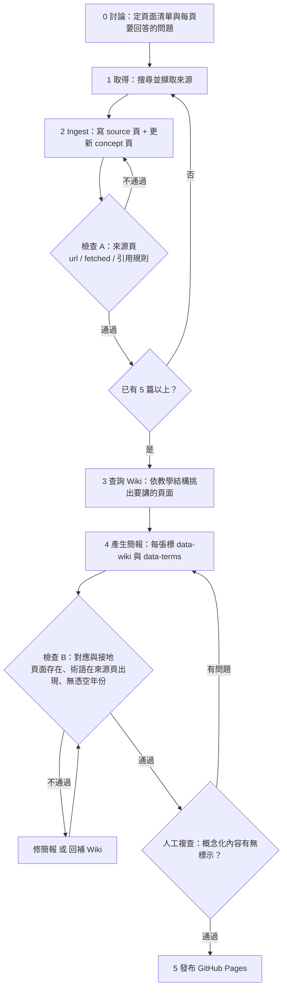

# Loop / Graph 設計

## 流程圖

## 各節點在做什麼
| 節點 | 內容 | 輸出 |
|---|---|---|
| 0 討論 | 先決定頁面清單與每頁要回答的問題（寫在 `CLAUDE.md`） | Wiki 骨架 |
| 1 取得 | 搜尋、擷取官方／原始來源 | 原始摘要 |
| 2 Ingest | 一次一篇：先寫 `sources/`，再更新 `concepts/` | Wiki 頁面、`log.md` |
| 檢查 A | 來源頁完整、引用 ≤1 則且 ≤15 字、內文標註 `[src-NN]` | 錯誤清單 |
| 3 查詢 Wiki | 依「動機→定義→組成→運作→模式→風險→使用時機→測驗」挑頁面 | 簡報大綱 |
| 4 產生簡報 | 每張投影片宣告 `data-wiki`、`data-terms` | `index.html` |
| 檢查 B | 對應頁面存在；術語都出現在來源頁；沒有來源頁沒有的年份；每個概念頁至少被用到一次 | 錯誤清單 |
| 人工複查 | 檢查腳本只看「字有沒有出現」，語意與「概念化內容」要人看 | 修改清單 |

## 哪些步驟會重複執行？
- **2 → 檢查 A → 2**：來源頁沒通過就回頭改，直到通過。
- **1 → 2**：來源不足 5 篇就繼續取得與 ingest。
- **4 → 檢查 B → 修正 → 檢查 B**：簡報有內容對不上 Wiki，就回頭修簡報或補 Wiki。

## 哪裡需要檢查或重新生成？
- Ingest 後立刻檢查來源頁（引用、url）。
- 簡報產生後檢查「簡報 ↔ Wiki」的對應。
- 最後由人複查腳本檢查不到的部分（語意、概念化示意是否標明）。

## 為什麼這樣設計？
1. **Wiki 是唯一知識來源**：簡報只能引用 Wiki，錯誤才有地方追查——要嘛是 Wiki 沒寫，要嘛是簡報寫過頭。
2. **檢查要機器化**：「術語要在來源頁出現」這類規則寫成腳本，每次重跑成本很低。
3. **檢查放在離錯誤發生最近的地方**：引用問題在 ingest 就擋，而不是等到簡報完成才發現。
4. 對應 Anthropic 文章中的 evaluator-optimizer 模式：產生 → 評估 → 不合格就回頭修（見 `wiki/concepts/workflow-patterns.md`）。
